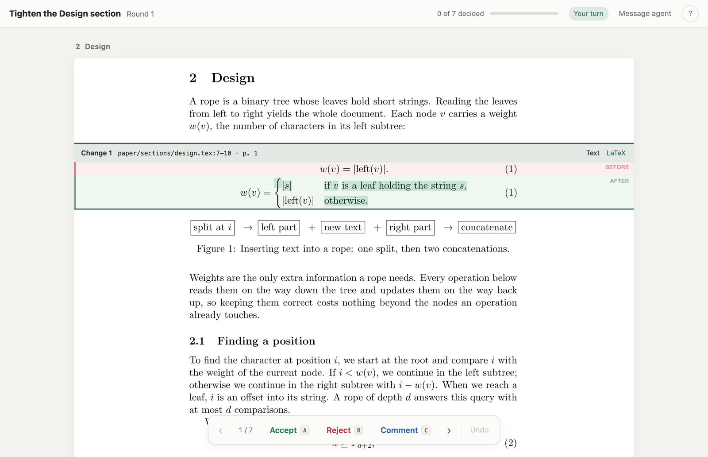

# latex-review-skill

Review your AI agent's LaTeX edits the way you read your paper: **as typeset PDF, change by change.**

The agent edits in its own Git worktree and publishes a round. A local page shows each change in place inside its section, with the old and new text, formulas and figures marked word by word. You **accept**, **reject** or **comment** on each change. Accepted changes are merged into your working tree right away. The agent reads your comments, revises, and publishes the next round.

Works with [Claude Code](https://claude.com/claude-code), [Codex](https://developers.openai.com/codex) and any agent that can run shell commands and read a `SKILL.md`.



## Quick start

```sh
# 1. Install the skill (pick your agent)
git clone https://github.com/cu1ch3n/latex-review-skill ~/.claude/skills/latex-review-skill   # Claude Code
git clone https://github.com/cu1ch3n/latex-review-skill ~/.codex/skills/latex-review-skill    # Codex

# 2. Check your setup (and download the PDF renderer once)
python3 ~/.claude/skills/latex-review-skill/scripts/review.py doctor

# 3. Try it on the bundled example paper, without an agent
python3 ~/.claude/skills/latex-review-skill/examples/demo.py
```

Then open your own LaTeX project (it must be a Git repository) and ask your agent, for example:

> Use latex-review-skill to tighten Section 3, and let me review the changes.

The agent starts a task, edits, publishes, and gives you the review link.

### Requirements

| | macOS | Linux |
| --- | --- | --- |
| Python 3.10+, Git | preinstalled or `brew install python git` | your package manager |
| TeX with `latexmk` and `synctex` | `brew install --cask mactex-no-gui`, or BasicTeX plus `sudo tlmgr install latexmk` | `sudo apt install latexmk texlive-latex-recommended` |
| [uv](https://docs.astral.sh/uv/) (installs PyMuPDF for rendering) | `brew install uv` | `curl -LsSf https://astral.sh/uv/install.sh \| sh` |

Node.js is not needed. Windows works through WSL.

## The example

`examples/demo.py` plays the agent's part. It copies `examples/paper` (a four-page note on ropes, a string data structure) into a temporary Git repository. It then starts a task scoped to the paper's *Design* section, applies the edits in `examples/agent-edits.json`, and publishes them. The round has seven changes:

- a definition rewritten as a `cases` equation,
- a change inside inline math, and a line of an `align` block,
- a long sentence tightened, which reflows its paragraph,
- a figure caption extended,
- a sentence deleted,
- a source line re-wrapped, which has no visible effect and is shown as a LaTeX diff.

Review them in the browser. Afterwards the script prints the `feedback` command, which shows exactly what an agent receives, and the commands to clean up.

## The review page

| Key | Action |
| --- | --- |
| `A` / `R` / `C` | Accept, reject, or comment on the current change |
| `J` / `K` | Next / previous change |
| `S` | Show the LaTeX source diff of the change |
| `⌘Z` or `U` | Undo the last decision (within the current round) |
| `M` | Send the agent a message |
| `?` | All shortcuts |

After each decision the page moves to the next undecided change. Decided changes show the version you chose. Long unchanged passages are folded. Undecided changes carry over to the next round, and a revised change shows the comment it answers.

What the decisions do:

- **Accept** merges the change into your working tree with a three-way merge, so your own edits are kept. Nothing is committed; you commit when you are ready.
- **Reject** reverts the change in the agent's worktree.
- **Comment** asks the agent to revise the change in the next round.

## How it works

```
agent:  start ─▶ edit worktree ─▶ publish ────────────▶ feedback --wait ─▶ revise ─▶ publish … ─▶ finish
                                     │                        ▲
                                     ▼                        │
you:                        review page: Accept · Reject · Comment, per change
```

`publish` snapshots the worktree and compiles both versions with `latexmk`. Long documents compile only the affected `\include` chapters. It then locates every change in both PDFs through SyncTeX, and renders the comparison as vector SVG. Every command prints one JSON object with a `next` field telling the agent what to do; [SKILL.md](SKILL.md) is the agent's manual.

```sh
review=~/.claude/skills/latex-review-skill/scripts/review.py
python3 $review start NAME [--section 3.2]... [--file path]... [--title TEXT]   # in the repository
python3 $review publish            # in the worktree: compile, render, wait for the build
python3 $review feedback [--wait SECONDS] [--all]
python3 $review status | list | finish [--force] | doctor
python3 $review server status | stop
```

## Configuration

Usually nothing is needed. The root document is detected from `@default_files` in a `latexmkrc`, or as the only `.tex` file with `\documentclass`. The engine comes from a `% !TEX program` line, `$pdf_mode` in the latexmkrc, or the packages used (e.g. `fontspec` means XeLaTeX). To override, put a `.latex-review.json` at the repository root:

| Setting | Meaning |
| --- | --- |
| `main` | Root document, e.g. `"paper/main.tex"` |
| `engine` | `"pdflatex"`, `"xelatex"` or `"lualatex"` |
| `latexmkrc` | latexmkrc to use (default: next to the root document) |
| `source_dir` | Folder copied for each build (default: the root document's folder; use `"."` if the document inputs files outside it) |
| `partial_builds` | `false` to always compile the whole document |
| `preload` | For partial builds: `\include` target → file to `\input` when that chapter is left out (e.g. macros it defines) |
| `dependencies` | For partial builds: `\include` target → targets that must be compiled with it |
| `figures` | Folders whose files are reviewed as whole figures (default: `figures/` or `figs/` beside the root document) |
| `worktrees` | Where task worktrees go (default: `../<repository>-tasks/`) |

## Good to know

- The in-context section view needs PDF bookmarks, which `hyperref` provides. Without them, changes are shown as standalone crops.
- Section scopes understand `\part` … `\subsubsection`, literal `\input`/`\include`/`\subfile`, and `\label`s.
- The first publish of a task compiles the whole document once. Later rounds reuse it.
- Your branch, `HEAD` and staging area are never touched. Every write is journaled, so an interrupted accept or undo finishes when the server restarts.
- State lives in `.git/latex-review/` (and `refs/latex-review/`); `finish` cleans up. The local server listens on 127.0.0.1 only, rejects cross-origin requests, and exits after 12 idle hours.

## Development

```sh
make check   # lint, Python tests (under uv, with the renderer's packages) and JavaScript tests
make demo    # the example above
```

```
latex_review/        cli · client · server              agent CLI, server discovery, HTTP API
                     tasks · review · publish             worktrees, decisions and undo, building rounds
                     build · changes · outline · git · config · store
latex_review/render/ PDF locating, glyph diffs and SVG strips (runs under uv with PyMuPDF)
web/                 the review page: plain ES modules, no build step
examples/            the example paper and the demo script
```

## License

[MIT](LICENSE)
