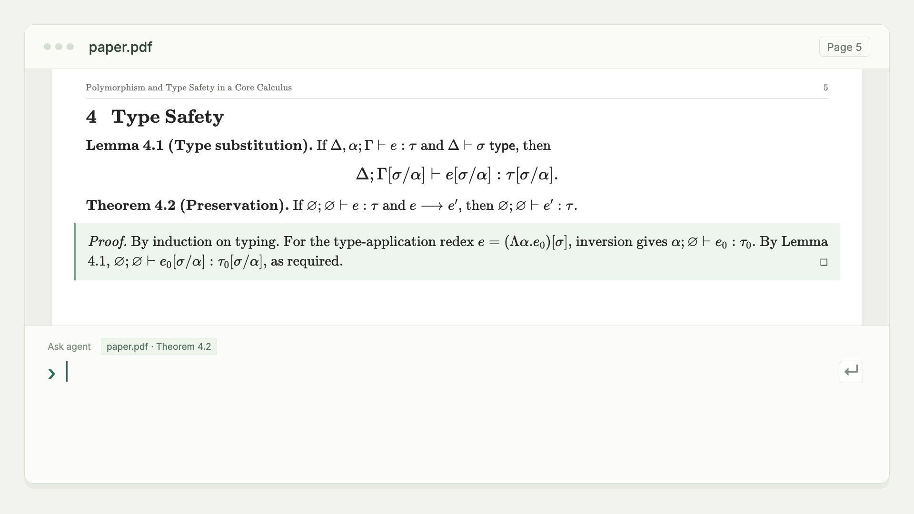

<h1 align="center">
  
</h1>

<p align="center"><a href="README.md">English</a> · <strong>简体中文</strong></p>

直接在 PDF 中审阅 agent 的 LaTeX 修改。接受、拒绝或评论，意见通过 CLI 返回给 agent。



## 安装

需要 macOS 或 Linux、Node.js 22.22+、Git，以及含 `latexmk` 和 `synctex` 的 TeX Live 或 MacTeX。

```sh
npx skills add cu1ch3n/latex-review-skill -g
```

## 使用

在 agent 中打开你的 LaTeX Git 仓库，然后提出请求：

> 使用 latex-review-skill 精简第 3 节，保留原有技术含义。修改合入稿件之前，让我先审阅。

打开 agent 提供的审阅链接，对照 PDF 和源文件差异，接受、拒绝或评论。接受的修改合入工作区，不会自动创建 commit。

- 直接选择、复制 PDF 文字，通过 minimap 跳转到各处改动。
- 告诉 agent **“全部接受”**，即可通过 CLI 批量应用待定修改。
- 保持 agent 会话运行；完成整轮审阅后，意见会自动返回。

[技术参考](docs/reference.md) · [Agent 指南](SKILL.md) · [测试与语料](docs/corpus.md) · [MIT 许可证](LICENSE)
